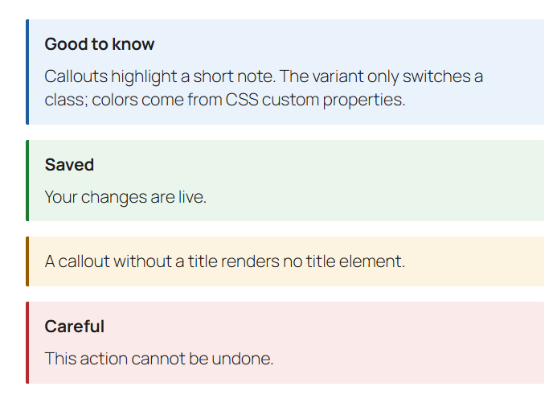
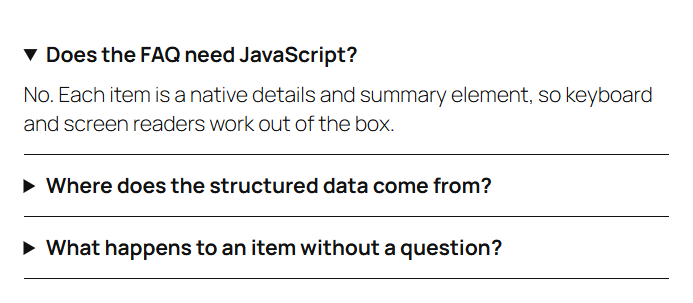
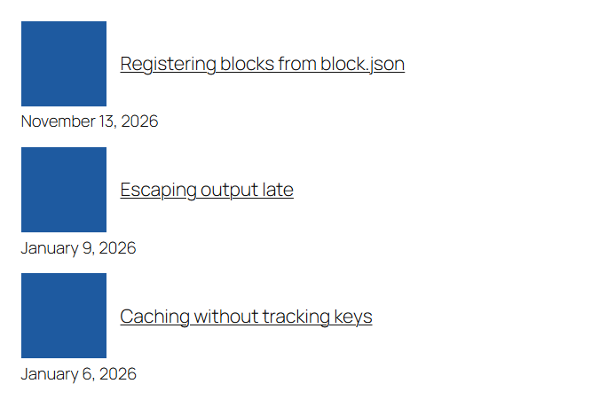

# AF Blocks

A small WordPress plugin with three custom Gutenberg blocks. Each block demonstrates a different skill: a static block, a parent/child block rendered in PHP with structured data, and a dynamic block with a cached query.

Study project. The full specification is in [docs/SPEC.md](docs/SPEC.md).

## The problem

Most custom block tutorials stop at "it renders". The hard parts show up later:

- static blocks break when their saved markup changes;
- accordions often ship JavaScript and lose keyboard or screen reader support;
- structured data gets printed twice, or with unescaped content;
- "related posts" widgets run a heavy taxonomy query on every page view, and their caches either go stale or need to track every key they wrote.

This plugin handles each of those on purpose, and keeps the rules simple: escape late, sanitize early, no front-end JavaScript, and a block with no meaningful content renders no markup.

## The blocks

### Callout (`af-blocks/callout`, static)



A note with a variant (`info`, `success`, `warning`, `danger`), an optional title and the content.

- The variant only switches a class (`is-variant-info`). Colors come from CSS custom properties, so the variant adds no inline styles.
- Without a title there is no title element. Without content the block saves nothing.
- Text contrast is above 14:1 on all four backgrounds.

### FAQ and FAQ item (`af-blocks/faq`, `af-blocks/faq-item`)



A parent block that only accepts FAQ items. Each item is a question and an answer (paragraphs and lists).

- Items are native `<details>`/`<summary>`: keyboard and screen readers work with no JavaScript.
- The FAQ renders in PHP and prints `FAQPage` JSON-LD, once per page, built from the questions and the answers as plain text.
- Items with an empty question are not rendered; items with an empty question or answer are left out of the schema.

### Related Posts (`af-blocks/related-posts`, dynamic)



Posts that share a category or tag with the current post, with an optional thumbnail and date. Number of posts (1–6), taxonomy and display options are set in the sidebar; the editor shows a live server-side preview.

- Runs only on a single post (and in its editor preview). Anywhere else it renders nothing.
- Results are cached, and the cache is invalidated without tracking keys (see below).
- Every value is escaped at output: a post titled `<script>alert(1)</script>` prints as text.
  Note: WordPress core blocks such as Post Title and Post Navigation Link print titles as HTML by design, for users with the `unfiltered_html` capability (administrators). On a test page, that script runs from those core blocks, not from this one.

## Decisions and trade-offs

**Static blocks need deprecations.** A static block's markup is stored in the post and checked against `save()` every time the editor loads. If `save()` changes after release, existing blocks no longer match and the editor flags them as invalid. Any change to the Callout or FAQ item markup must add a `deprecated` entry with the old `save()` so existing content migrates.

**FAQ items always save their markup.** When a static block's `save()` returns nothing, its inner blocks are not saved either, so an item with an empty question would lose its answer. Instead, the item always saves, and the parent FAQ skips items without a question when it renders. Cost: the parent renders each item itself, so items are rendered twice per request (WordPress already rendered them into `$content`). For an FAQ this is negligible.

**The question lives in the block comment.** PHP cannot read attributes that are sourced from HTML, so the FAQ item stores `question` in the block comment. `render.php` reads it directly to build the schema. The text is stored twice in the post (comment and `<summary>`).

**One `FAQPage` per page.** A static flag in PHP lets only the first FAQ that actually prints schema do so. An FAQ with schema turned off does not use up that one slot. The JSON is printed with `wp_json_encode()` and `JSON_HEX_TAG`, so a question containing `</script>` cannot close the tag.

**Invalidation without tracking keys.** Related post IDs are stored in a transient for 12 hours. The key holds the post ID, a hash of the attributes that change the result (`taxonomy`, `count`) and a cache version number. `save_post`, `deleted_post` and `set_object_terms` (for posts only) bump the version. Old keys are never deleted one by one: nothing points to them any more, and they expire. The trade-off is some dead transients in the database until they expire, in exchange for no bookkeeping and no race between writers.

**What "cached" costs, measured.** Measured on a Docker stack built from the official `wordpress:php8.1-apache` and `mariadb:11` images (WordPress 6.9), with Query Monitor 4.1.1. Query Monitor labels these queries "WordPress Core", because they are core functions; they were counted from its stack traces, keeping only queries with `related-posts/render.php` in the trace. A `SAVEQUERIES` probe gave the same counts. The block's render ran:

| View | Queries | What runs |
|---|---|---|
| First view after an edit | 9 | taxonomy query, transient write, post loads |
| Next views | 5 | transient read, posts and meta by ID, thumbnails by ID |

No taxonomy query runs on a cached view. The remaining five are primary-key reads; with a persistent object cache (Redis, Memcached) they come from memory instead of the database.

**Editor preview.** `ServerSideRender` previews come from a REST request, where `is_singular()` is always false. The block also renders for its own `block-renderer` endpoint when the edited item is a post, and nowhere else in REST (it does not leak into `content.rendered`).

**WordPress 6.6 or later.** Current `@wordpress/scripts` compiles JSX against the `react-jsx-runtime` script, which WordPress ships from 6.6.

**`build/` is committed.** The repository works as a zip install with no build step. CI rebuilds and fails if `build/` is out of date.

## How to run

Requirements: Node 20+, PHP 8.1+, Composer 2 and Docker.

```sh
npm ci
composer install
npm run build
npm run env:start
```

WordPress runs at http://localhost:8888 (user `admin`, password `password`) with `WP_DEBUG` on and the plugin mounted. `npm run env:stop` stops it.

| Command | What it checks |
|---|---|
| `npm run build` | Builds every block into `build/` |
| `npm run start` | Rebuilds on change |
| `npm run lint:js` · `npm run lint:css` | `@wordpress/scripts` lint rules |
| `composer phpcs` | WordPress Coding Standards 3.x |

CI (`.github/workflows/ci.yml`) runs PHPCS, then build, the `build/` check and both linters, on every push and pull request.

## Limitations

- No automated tests yet: behavior was verified by hand against a real WordPress install (see the measurements above).
- `wp-env` with Docker fails on Windows when the system user name contains a space (it creates a container user with that name). Use WSL, or a user name without spaces.
- The Callout variant is shown by color and border only. Screen readers do not announce "warning" or "danger"; the title should carry that meaning.
- A Callout with a title but no content saves nothing, title included.
- Only the first FAQ rendered in a request prints schema. If a template part with an FAQ renders before the post content, that one wins.
- Related Posts supports categories and tags only, uses the `thumbnail` image size, and still needs a few primary-key reads per view without a persistent object cache.

## Next steps

- PHPUnit tests for the render callbacks: `count` clamping, schema rules, cache version bumps.
- End-to-end editor tests (Playwright): inserting blocks, the FAQ template, the Related Posts preview.
- Remove the empty-input flags from the lint scripts (they were needed only while there were no blocks).

## License

GPL-2.0-or-later. See [LICENSE](LICENSE).
